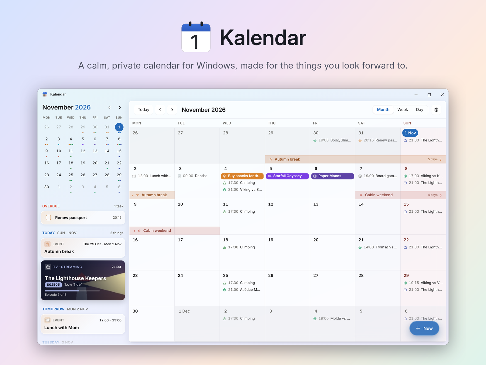
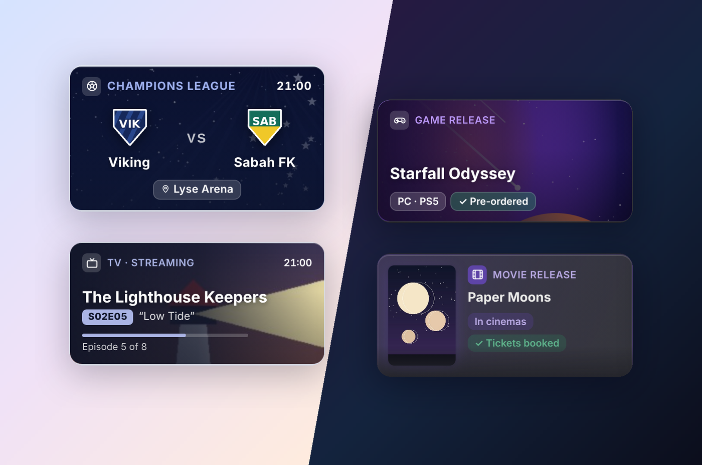
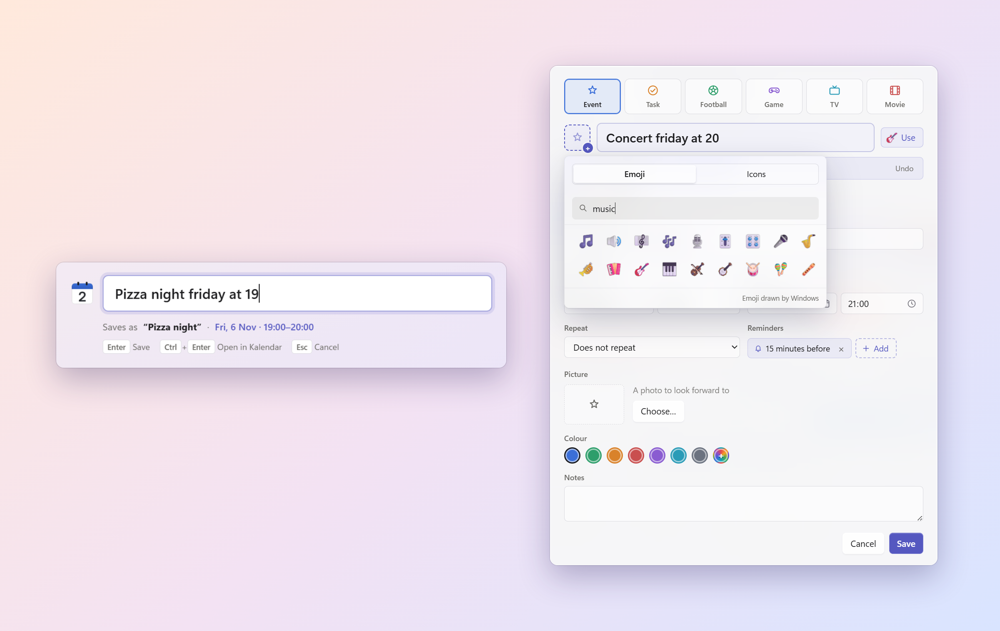
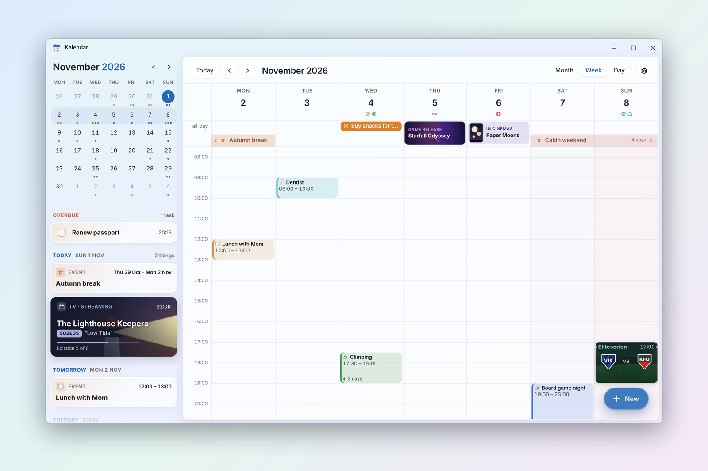
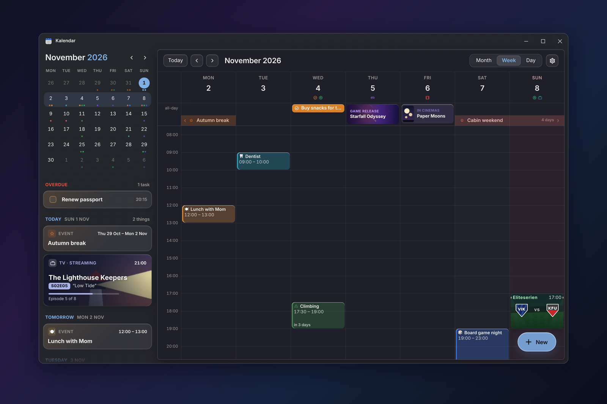
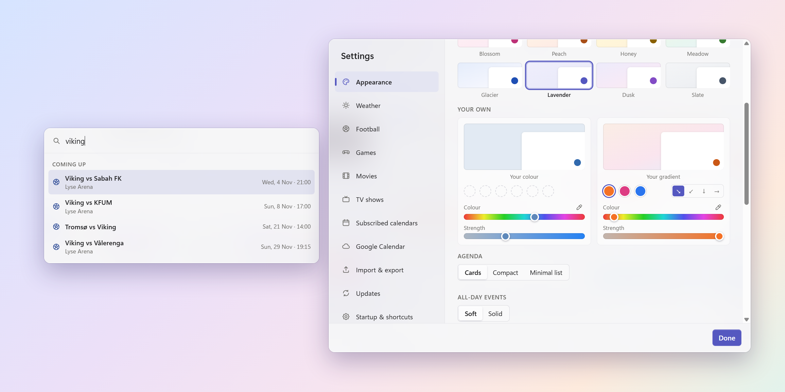

  

  <b>A calm, private calendar for Windows, made for the things you look forward to.</b> 
  Matches, game releases, new episodes, cinema nights, and everything in between.

  <a href="https://github.com/ecnot/kalendar/releases/latest"><b>⬇ Download for Windows</b></a>
  &nbsp;·&nbsp; Windows 10 and 11 &nbsp;·&nbsp; Free

---

## Why Kalendar?

Most calendars are built for meetings. Kalendar is built for the good stuff: the match on Sunday, the game you pre-ordered, the season finale, the cabin weekend. Every kind of plan gets its own card, with pictures, colours and the details that matter, so the next few weeks look like something to look forward to, not a to-do list.

Your calendar lives on your own PC. No account, no sign-in, no cloud, unless you choose to sync with Google Calendar.

  

## Features

**Cards for everything**
- **Football:** both team logos, the competition, the stadium, and a picture per competition. Subscribe to your team's FotMob calendar and fixtures, kick-off changes and results arrive by themselves. On match days the app takes your team's colour.
- **TV shows:** follow a show and every new episode appears automatically, with season, episode number and title.
- **Movies:** search a film and get its release date for your country (cinema or streaming), poster and summary.
- **Games:** search a game on IGDB and get its release date and cover, with your own free Twitch keys. Upcoming dates stay up to date.
- **Birthdays, tasks and events,** with your own pictures. Colours are picked from the picture automatically. Birthdays stand out, and tasks can be ticked off right in the calendar.
- **Countdowns:** right-click anything and choose "Count down to this".

**Fast to fill in**
- **Type it like you'd say it:** *"Lunch with mom tomorrow at 12"* fills in the date and time, and saves as "Lunch with mom".
- **Quick add from anywhere:** press Ctrl+Alt+K, or a shortcut of your own, without opening the app. Inside the app, hover any day and click **+**, or press **N**.
- **Custom icons for any card:** about 1,900 emoji or 4,800 line icons. Type "Concert" and it suggests 🎸.

  

**See your days**
- **Month, week, 3-day and day views,** with a scrolling month view, multi-day events drawn as connected bars, and optional week numbers.
- **Weather from Yr** on the days ahead, for your own place.
- **Sunrise and sunset** as times, as lines across the day, or both. See at a glance whether the sun sets during your plans.
- **Public holidays and flag days** for Norway, Sweden, Denmark, Finland, Iceland, Germany, the UK and the US.
- **An agenda beside the calendar** that never runs out, in three styles. Right-click any card to make it bigger or smaller.
- **Search** titles, notes and details with Ctrl+F.
- **A small agenda in the tray,** and today's date on the taskbar and tray icon.

  

**Looks the part**
- **Eight pale gradient themes,** or your own colour or gradient.
- **Light and dark,** following Windows or your own choice, with adjustable transparency.
- **All-day events your way:** soft pastels that match the rest of the calendar, or solid colours that really stand out.
- **Small seasonal touches,** like confetti at New Year and on your national day, and an optional Christmas theme.
- **In English and Norwegian.**

  

  

**Quietly reliable**
- **Reminders** as Windows notifications, even when the window is closed. Kalendar waits in the tray.
- **Repeating events,** with single days skippable.
- **Google Calendar sync** if you want it, and **.ics import and export** for Outlook, Apple Calendar and others.
- **Starts with Windows** if you like, minimised to the tray.
- **Updates itself** when a new version is released here.

## Install

1. Download **`Kalendar-Setup-x.y.z.exe`** from the [latest release](https://github.com/ecnot/kalendar/releases/latest).
2. Run it. Windows may say *"Windows protected your PC"*, because Kalendar is a free hobby app without a paid code-signing certificate. Click **More info → Run anyway**.
3. That's it. Future versions install themselves; you'll see *"Kalendar is ready to update · Restart now"*.

**Optional extras**
- **Movie search** needs a free API key from [TMDB](https://www.themoviedb.org/settings/api). Paste it in Settings → Movies. It's stored only on your PC.
- **Game search** needs a free Client ID and Secret from [Twitch](https://dev.twitch.tv/console/apps), which runs IGDB. Add them in Settings → Games. They're stored encrypted on your PC.
- **Your football team's fixtures:** in the FotMob app, open your team and copy its calendar link into Settings → Subscribed calendars.

## Privacy

Your events, pictures and settings are stored on your own PC, in `%APPDATA%\Kalendar`. There's no account of ours to sign in to. Kalendar only goes online for the features you use:

| Feature | Service | What is sent |
|---|---|---|
| Place suggestions | [Photon](https://photon.komoot.io) (OpenStreetMap) | What you type in a location field |
| TV shows | [TVmaze](https://www.tvmaze.com) | Show names you search for |
| Movies | [TMDB](https://www.themoviedb.org) | Movie titles you search for, with your own key |
| Games | [IGDB](https://www.igdb.com) and Twitch | Game titles you search for, with your own keys |
| Weather | [MET Norway](https://api.met.no) (Yr) | The coordinates of the place you choose |
| Google Calendar | Google, directly from your PC | The calendars you choose, if you connect an account |
| Team logos | [TheSportsDB](https://www.thesportsdb.com) | Team names, when you press "Find logos online" |
| Subscribed calendars | The link you add (e.g. FotMob) | A normal download of that calendar |
| Updates | GitHub | A check for the newest version |

No tracking, no analytics, no ads.

## Credits

- **Movie data:** [TMDB](https://www.themoviedb.org). *This product uses the TMDB API but is not endorsed or certified by TMDB.*
- **TV data:** [TVmaze](https://www.tvmaze.com) (CC BY-SA).
- **Game data:** [IGDB](https://www.igdb.com).
- **Weather:** [MET Norway](https://www.met.no) (Yr), CC BY 4.0.
- **Team badges:** [TheSportsDB](https://www.thesportsdb.com).
- **Places:** [Photon](https://photon.komoot.io), © [OpenStreetMap](https://www.openstreetmap.org/copyright) contributors.
- **Icons:** [Tabler Icons](https://tabler.io/icons) (MIT). **Emoji keywords:** [Emojibase](https://emojibase.dev) (MIT).
- **Fonts:** [Inter](https://rsms.me/inter/) and [Rajdhani](https://fonts.google.com/specimen/Rajdhani) (SIL Open Font License).
- **Confetti motion:** based on [confetti.js](https://confettijs.org).
- **Built with** [Electron](https://www.electronjs.org).

Team names, competitions and artwork in the screenshots are examples. The club badges shown are placeholders, not official logos.

---

Made in Norway with ☕ and a lot of football.

